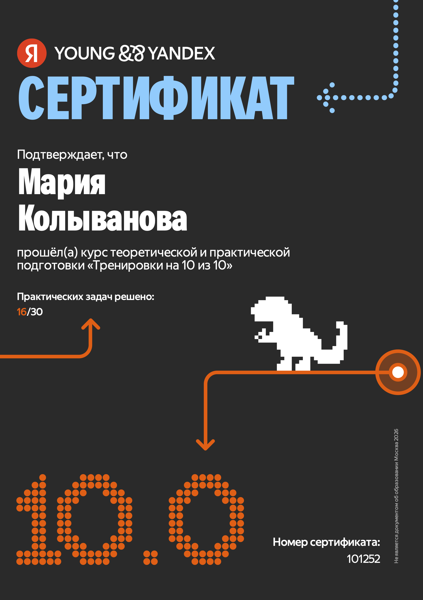
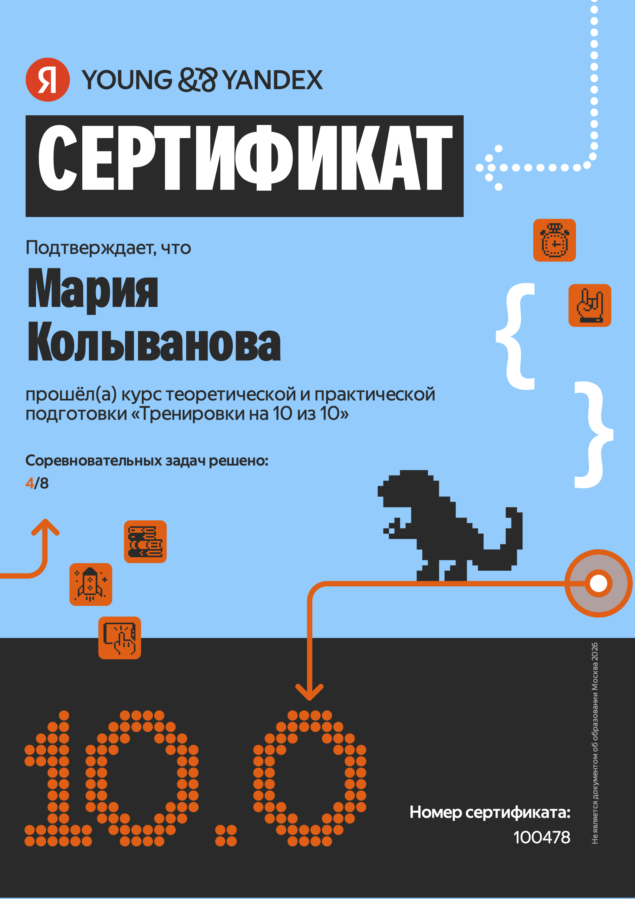

<h1 align="center">Мария Колыванова</h1>

Java-разработчик

    
    

Привет, я Мария! В 2026 году окончила вуз по направлению «Прикладная информатика в экономике».

Пробовала Frontend и Android, но в итоге отдала предпочтение backend-разработке.

Занимаюсь разработкой серверной части приложений на Java и Spring. Мне интересно проектировать REST API, работать с базами данных, настраивать безопасность и писать тесты.

## Проекты

### Pet-проект

- [Chatter](https://github.com/MariaKolyvanova/chatter) — веб-приложение с REST API для публикации коротких постов. Реализованы лента, ответы, лайки, репосты, подписки и инструменты модерации.

### Учебные работы
- [AgroPulse](https://github.com/MariaKolyvanova/AgroPulse) — веб-приложение (Spring MVC) для работы с финансовой отчётностью и ESG-показателями. Выпускная квалификационная работа.
- [Apiary Assistant](https://github.com/MariaKolyvanova/ApiaryAssistant) — Android-приложение для голосового заполнения отчётов. Курсовая работа.
- [ОргоМаркет](https://github.com/MariaKolyvanova/OrgoMarket) — сайт магазина органических продуктов. Курсовая работа.

### Решения задач
- [Algorithms and Data Structures](https://github.com/MariaKolyvanova/algorithms-and-data-structures) — решения задач по алгоритмам и структурам данных с LeetCode и CodeRun.

## Стек технологий

### Языки программирования

  

### Фреймворки

  
  
  

### Базы данных и ORM

  
  
  

### Безопасность

  
  

### Библиотеки

  
  
  

### API и документация

  
  
  

### Тестирование

  
  
  

### Инструменты

  
  
  
  

### Веб-технологии

  
  
  

## Курсы

Прошла курс Яндекса «Тренировки на 10 из 10» по алгоритмам и структурам данных.

  
  &emsp;
  

